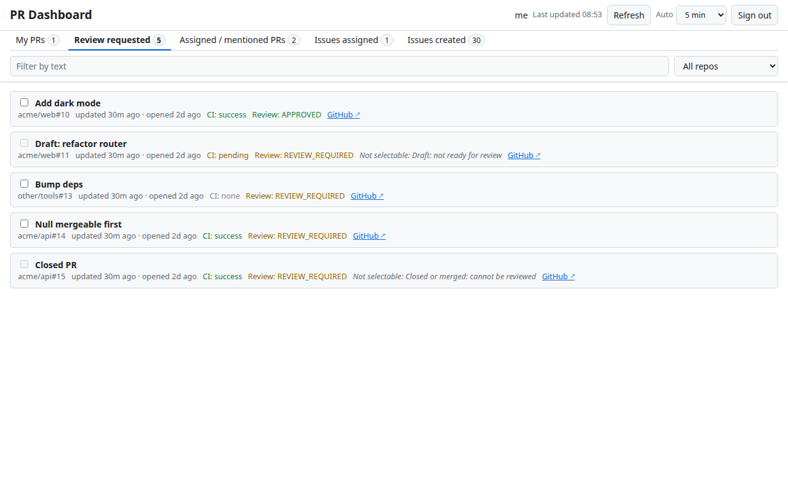
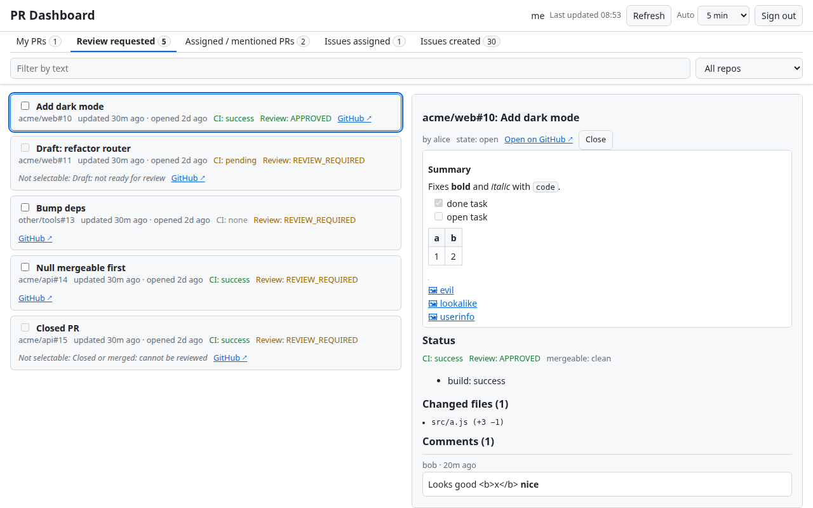
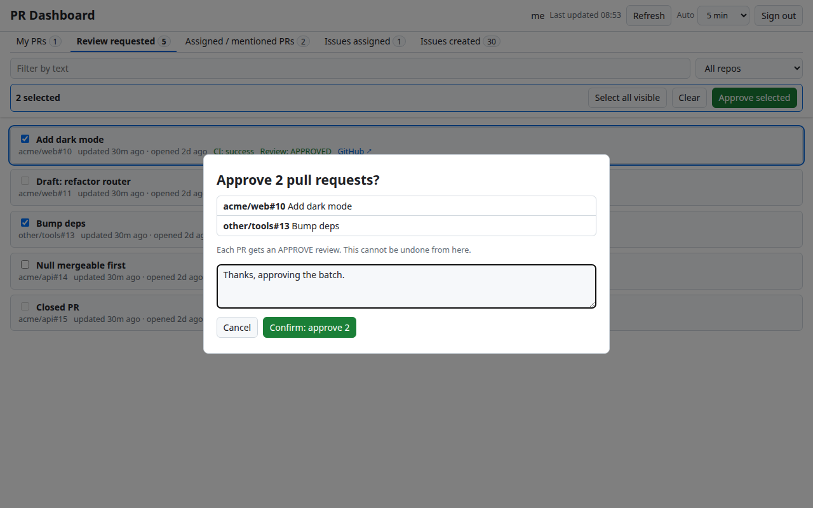
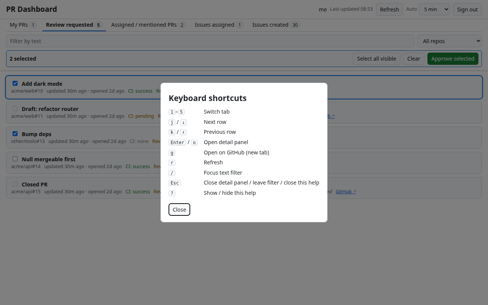
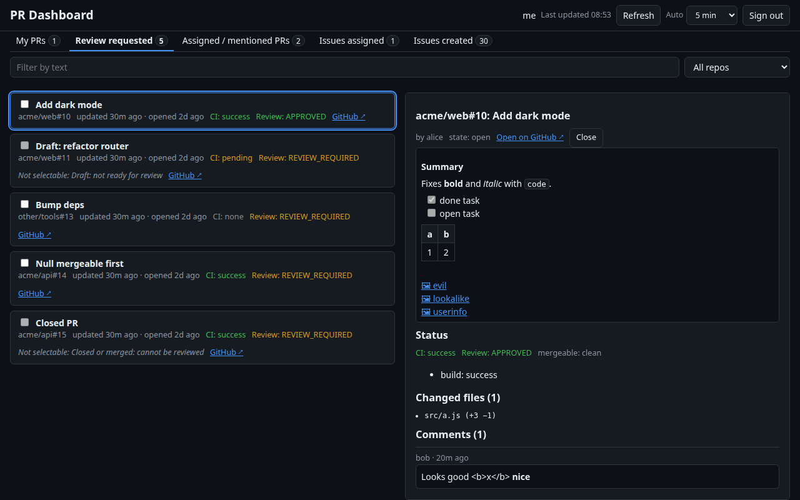
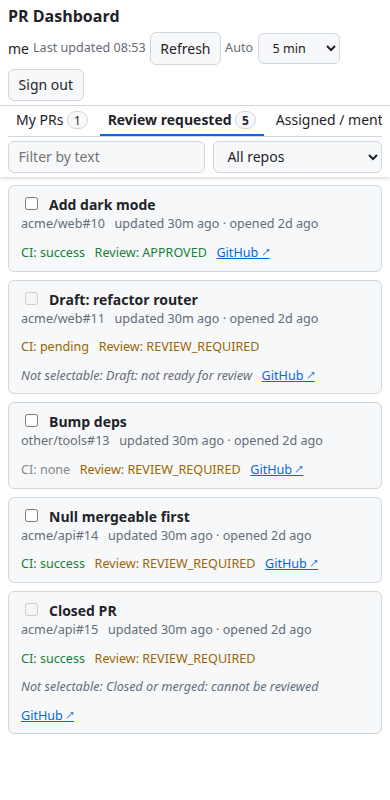

# GitHub PR Dashboard

A static, no-build dashboard (plain HTML/CSS/ES modules, no dependencies) for your open pull requests and issues on GitHub. See what needs your attention, check CI and review state at a glance, and act on items without leaving the page: approve, request changes, comment, close/reopen, merge, or bulk-approve several PRs at once.

Files: `index.html` (markup + CSP), `app.js` (all logic), `styles.css`. Deployed to GitHub Pages by `.github/workflows/pages.yml` on every push to `main`.

## Contents

- [Quick start](#quick-start)
- [Token setup](#token-setup)
- [Features](#features)
- [Keyboard shortcuts](#keyboard-shortcuts)
- [Security notes](#security-notes)
- [Testing](#testing)
- [Screenshots](#screenshots)

## Quick start

```sh
python3 -m http.server 8000
# open http://localhost:8000
```

Any static host works (e.g. GitHub Pages); there is nothing to build. Paste a token on the sign-in screen (see below) and the lists load.

## Token setup

1. GitHub → Settings → Developer settings → Personal access tokens → **Fine-grained tokens** → Generate new token.
2. Choose the repositories you want to see/act on (search results only include repos the token can access, plus public ones).
3. Repository permissions: **Pull requests: Read and write**, **Issues: Read and write**, **Metadata: Read**, **Checks: Read**, **Commit statuses: Read**, **Contents: Read** (**Contents: Write** is needed only to merge).
4. Paste the token on the sign-in screen.

Without Checks / Commit statuses / Pull requests read access the CI or Review column shows "no access" or "unknown" and a banner names the missing permission.

## Features

### Tabs and lists

Five tabs, each a GitHub search for open items (up to 50 per query, newest-updated first):

| Key | Tab | Search |
| --- | --- | --- |
| `1` | My PRs | `is:pr is:open author:@me` |
| `2` | Review requested | `is:pr is:open review-requested:@me` |
| `3` | Assigned / mentioned PRs | `is:pr is:open assignee:@me` + `mentions:@me` (merged, de-duplicated) |
| `4` | Issues assigned | `is:issue is:open assignee:@me` |
| `5` | Issues created | `is:issue is:open author:@me` |

Each tab shows an item count. A row shows title, `owner/repo#number`, labels, "updated … ago · opened … ago", a **GitHub ↗** link (PRs also show CI and Review status).

### Filters and persistence

- **Repo filter** – a dropdown grouped by owner (user/organization). Each group has an owner-wide option **`<owner> — all repos`** followed by that owner's individual repos; **All repos** clears the filter. Options come from the current tab's items. If the saved repo is not present in the current tab the dropdown falls back to All repos.
- **Text filter** – case-insensitive match on title, `owner/repo` and number. Not persisted.
- **Persistence** – these are kept in `localStorage`: the token, the selected tab, the repo filter, and the auto-refresh interval. The text filter, row selection and bulk selection are not.

### Detail panel

Click a row (or `Enter` / `o`) to open the detail panel: title, author, state, link to GitHub, the description rendered as Markdown, and all comments. For PRs it also shows CI, Review and mergeable state, the individual check runs, and the changed files with `+additions −deletions` (the count shows `+` when it reaches 100). The panel then offers the actions below. Scroll position of list and panel is preserved across refreshes.

### CI and review status

Fetched in the background after each refresh for every PR on the PR tabs (4 PRs at a time) and shown as `CI: …` and `Review: …` in the list and detail.

- **CI**: `success`, `failure`, `pending` (combined from check runs and legacy commit statuses; any failure wins, then pending), `none` (no CI configured), `no access` (the token lacks Checks / Commit statuses read; a banner names the permission), `error` (request failed; hover for the reason), `…` while loading.
- **Review**: `APPROVED`, `CHANGES_REQUESTED` (takes priority), `REVIEW_REQUIRED`, or `unknown` if reviews could not be read. Based on each reviewer's latest non-comment review.
- **mergeable** (detail only): GitHub's `mergeable_state`, or "computing…" while GitHub works it out (retried up to 3 times).

### Markdown and images

Bodies and comments are rendered by a small built-in renderer (`renderMarkdown` in `app.js`): headings, emphasis, strikethrough, inline/fenced code, blockquotes, lists, task-list checkboxes (read-only), tables, rules, links and autolinks (http/https/mailto only). Raw HTML is shown as text and `<!-- comments -->` are hidden. Output is built with DOM nodes only, never `innerHTML`.

**Image allow-list**: images load inline only over https from `github.com`, `github.githubassets.com` and `*.githubusercontent.com` (no userinfo or port; checked with `new URL()`, so lookalike hosts are rejected; also enforced by the CSP `img-src`). Any other host, or an image that fails to load, becomes a link showing `🖼 alt text`.

### Actions

Available in the detail panel, with a shared comment box:

| Action | Applies to | Notes |
| --- | --- | --- |
| Comment | PRs and issues | Requires text. |
| Approve | PRs | Comment optional. |
| Request changes | PRs | Comment required. |
| Merge | PRs | Merge commit; asks for confirmation first. |
| Close / Reopen | PRs and issues | Label flips with the item state. |

**Gating**: Approve and Request changes are disabled, with an explanation, on your own PRs and on closed/merged PRs (GitHub rejects both with a 422). Drafts show a note that reviews may be rejected. After an action succeeds the lists refresh and the panel reloads. API errors show GitHub's message plus its detailed reasons in the red banner.

### Bulk approve

On the PR tabs each row has a checkbox. Once at least one is ticked, a toolbar under the filters shows the count with **Select all visible**, **Clear** and **Approve selected**.

- Own PRs, closed/merged PRs and drafts cannot be selected; the tooltip and row say why.
- The selection only holds PRs that are currently visible: changing the text or repo filter, or a refresh removing a row, drops hidden PRs (they are not re-selected when the filter is cleared). It is cleared on tab switch and sign out. Ticking a box does not open the detail panel.
- **Approve selected** opens a confirmation dialog listing every `repo#number` and title, with an optional comment shared by all approvals. Focus starts on Cancel and nothing is sent until you click **Confirm**; the dialog traps focus and `Esc` cancels (not while running).
- PRs are approved one at a time with per-PR progress. A failure (e.g. 422/403, with GitHub's reason) does not stop the rest; a 401 or a rate limit stops the batch, leaving the rest "not attempted". The summary reads "N approved, M failed" and **Retry failed** (labelled **Retry failed and not attempted** after a stopped batch) re-runs only the failed and not-attempted PRs (earlier reasons are kept if a retry is blocked by a rate limit; retry rounds are reported separately). Statuses are refreshed once at the end.
- There is deliberately no keyboard shortcut for bulk approve.

### Auto-refresh and header

- Lists refresh every 5 minutes by default; change it with the **Auto** selector (Off, 2, 5, 10 min). **Last updated HH:MM** sits next to **Refresh**.
- Auto-refresh pauses while the tab is hidden (and refreshes on return if stale) and is skipped while signed out, rate limited, or while a comment/approve/merge/close/bulk action is in flight. A failed auto-refresh keeps the old data.
- The header, tabs, filters and bulk toolbar are **sticky**, and keyboard navigation scrolls rows clear of them.

## Keyboard shortcuts

Press `?` in the app for the same list. Shortcuts are ignored while typing in a field, when Ctrl/Alt/Meta is held, while the bulk dialog is open, and (except `Esc` / `?`) while the help overlay is open. There is deliberately no approve/merge shortcut.

| Key | Action |
| --- | --- |
| `1`–`5` | Switch tab |
| `j` / `↓`, `k` / `↑` | Move the highlighted row down / up |
| `Enter` or `o` | Open the highlighted item's detail panel |
| `g` | Open the highlighted item on GitHub (new tab) |
| `r` | Refresh (ignored while a refresh/action is in flight or rate-limited) |
| `/` | Focus the text filter |
| `Esc` | Close the detail panel, or leave the filter box |
| `?` | Show / hide the help overlay |

## Security notes

- The token is kept in `localStorage` only and sent only to `https://api.github.com`. **Sign out** removes it. A 401 response also signs you out.
- A Content-Security-Policy (`<meta>` in `index.html`) restricts `connect-src` to api.github.com, `img-src` to self, github.com, `*.githubusercontent.com`, github.githubassets.com and `data:`, and allows only same-origin scripts and styles (no inline scripts), with `object-src 'none'`, `base-uri 'none'` and `form-action 'none'`.
- All API-provided text is inserted via `textContent`/text nodes; no `innerHTML`. External links use `rel="noopener noreferrer"`; GitHub links are only followed if they are https on `github.com`.
- Anyone with access to your browser profile, or an XSS on the host origin, can read the token; use a short-lived, minimally scoped token and host on an origin you control.
- Rate limits and API errors are shown in the red banner at the top.

## Testing

The full strategy, what is and is not verified, a manual checklist for every feature and error case, and a real-GitHub smoke test are in **[docs/TESTING.md](docs/TESTING.md)**.

Automated end-to-end checks run against an in-memory fake of the GitHub API (dev-only, in `tests/`; the app itself stays dependency-free):

```sh
cd tests && npm install --no-save --no-package-lock playwright && npx playwright install chromium && cd ..
node tests/run.mjs        # 50 checks, exit code 1 on failure
node tests/shots.mjs      # regenerate the screenshots below
```

These checks use mocked responses only; behaviour on real GitHub still needs the manual smoke test.

## Screenshots

Generated against the mock API (`node tests/shots.mjs`), so the data is fake.

| | |
| --- | --- |
|  |  |
|  |  |
|  |  |
